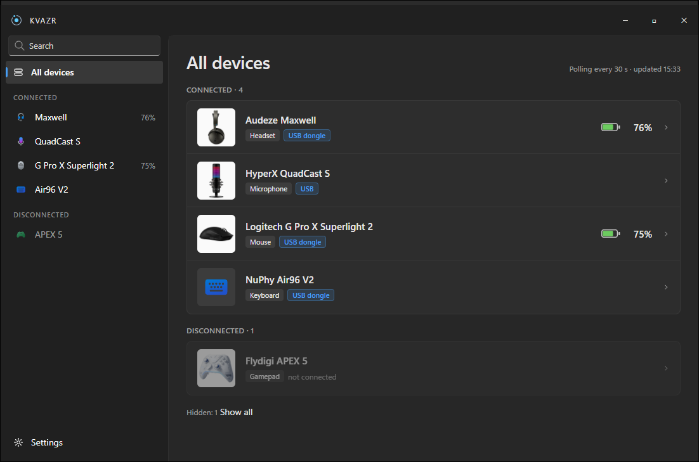
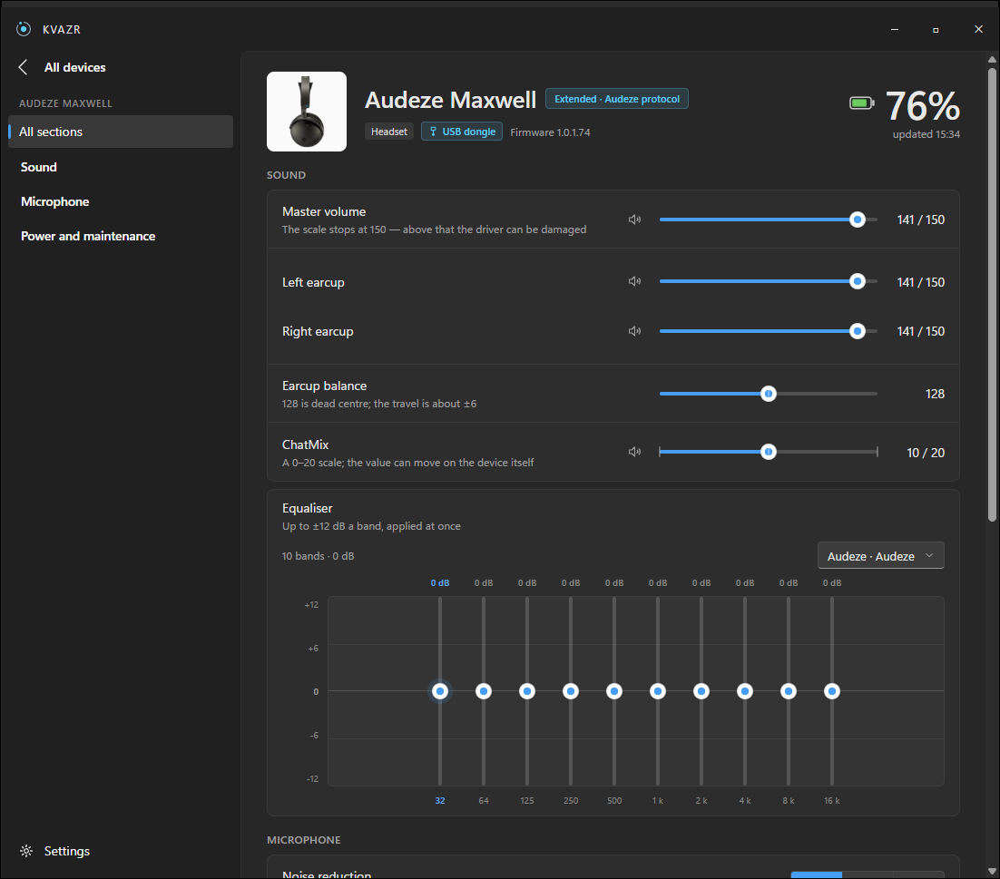

# KVAZR

A tray companion for the gear on your desk. Headsets, mice, keyboards, microphones and
gamepads from different vendors in one place: battery in the tray, a flyout when a device
connects, and a page per device for the settings it actually has. One small app instead
of a vendor app for each device.

KVAZR began as a replacement for Audeze HQ for the Audeze Maxwell and grew from there.
It speaks each device's own protocol where that is worth the reverse engineering, and a
shared class protocol where one protocol covers a whole family.





## What it does

- **Tray icon with the charge** of the device you care about, and low-battery notifications.
- **Flyout** when a device connects or disconnects.
- **Dashboard** of everything connected, and the devices seen before.
- **Device pages built from what the device can do**: KVAZR asks the device for its ranges
  (DPI, polling rates, gain) instead of hard-coding them.
- **Receivers, dongles and docks stay under their device**, not as separate entries.
- **Global hotkeys, profiles and autostart.**

## Devices

| Device | How KVAZR talks to it | What you get |
|---|---|---|
| Audeze Maxwell | RACE, Audeze's own protocol, over cable or the wireless dongle | Battery, EQ presets, gain and balance, ChatMix, firmware version |
| Logitech mice and keyboards | HID++ 2.0, one driver for the whole family | Battery, DPI, polling rate |
| VIA / QMK keyboards | VIA | What the keyboard reports over VIA |
| HyperX QuadCast S | Its own HID status channel | Status and light bars on top of the audio basics |
| Flydigi APEX 5 | Its own channel through the dongle | Battery |
| Apple AirPods | Bluetooth LE advertisements | Battery of each bud and the case |
| Any headset, microphone or speaker | Windows Core Audio | Volume, mic level, default device |

Support for a device is written against the hardware on the desk; the notes behind each
one are in [`docs/`](docs).

## Platforms

- **Windows 10 1809 or later, x64**: the main target.
- **Linux**: the app runs and reads HID devices through `hidraw` once the udev rule is
  installed. Vendor channels that are Windows-only and global hotkeys are not available.
- **macOS**: not supported yet.

## Install

Download `KVAZR.exe` from [Releases](../../releases) and run it. It is one self-contained
file, needs no .NET install and writes only to `%APPDATA%\KVAZR\settings.json`.

For Linux, see [`packaging/README.md`](packaging/README.md).

## Build

Requires the .NET 10 SDK.

```
dotnet build KVAZR.slnx
```

Close a running KVAZR first: it holds `Kvazr.Core.dll` and `Kvazr.Race.dll` open and
the build fails with MSB3027.

Tests run on Microsoft.Testing.Platform. Run the test executables directly; `dotnet test`
reports zero tests in this tree:

```
./tests/Kvazr.Race.Tests/bin/Debug/net10.0-windows/Kvazr.Race.Tests.exe
./tests/Kvazr.Core.Tests/bin/Debug/net10.0-windows/Kvazr.Core.Tests.exe
./tests/Kvazr.App.Tests/bin/Debug/net10.0-windows/Kvazr.App.Tests.exe
```

Publishing is described in [`packaging/README.md`](packaging/README.md).

## Layout

| Project | Role |
|---|---|
| `src/Kvazr.Race` | Transports and protocol codecs: HID on Windows and Linux, Bluetooth, RACE, HID++, VIA |
| `src/Kvazr.Core` | Drivers, the device registry, polling, profiles and settings |
| `src/Kvazr.App` | The app: Avalonia tray and flyout, Blazor content pane |
| `src/Kvazr.Cli` | `kvazr`, the diagnostic harness: probes like `kvazr --desk`, `--live`, `--hidpp` |

How drivers are organised and how a new device is added: [`docs/ARCHITECTURE.md`](docs/ARCHITECTURE.md).

## Trademarks

Audeze, Logitech, HyperX, Flydigi, NuPhy, Apple, AirPods and other names are trademarks
of their owners. KVAZR is not affiliated with or endorsed by any of them. Device photos
and their origins are listed in
[`src/Kvazr.App/Assets/Devices/images.json`](src/Kvazr.App/Assets/Devices/images.json).

## License

Proprietary. Copyright (c) 2026 Eduard Poul. All rights reserved. See [LICENSE](LICENSE).
